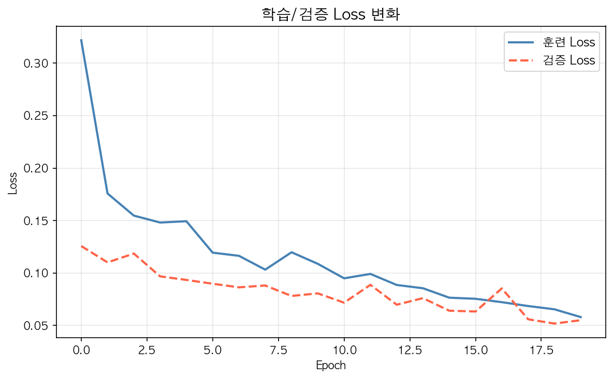
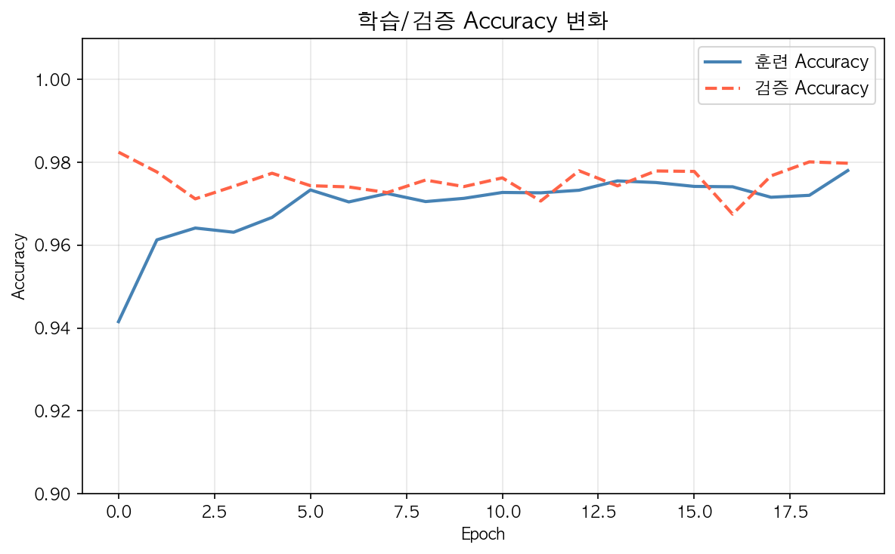
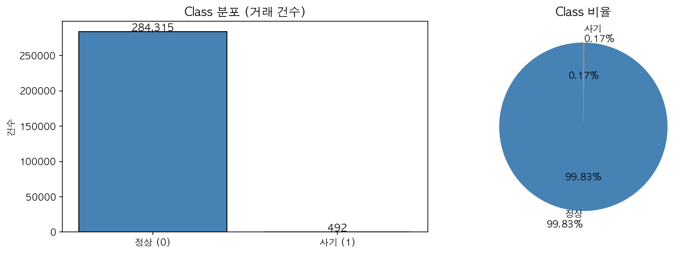
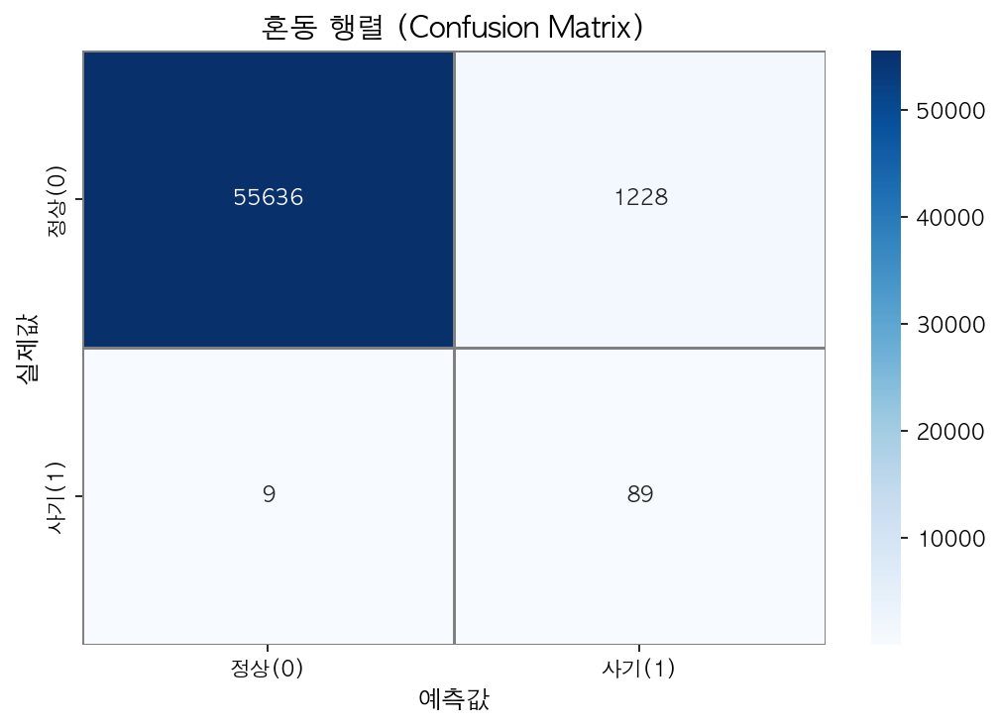
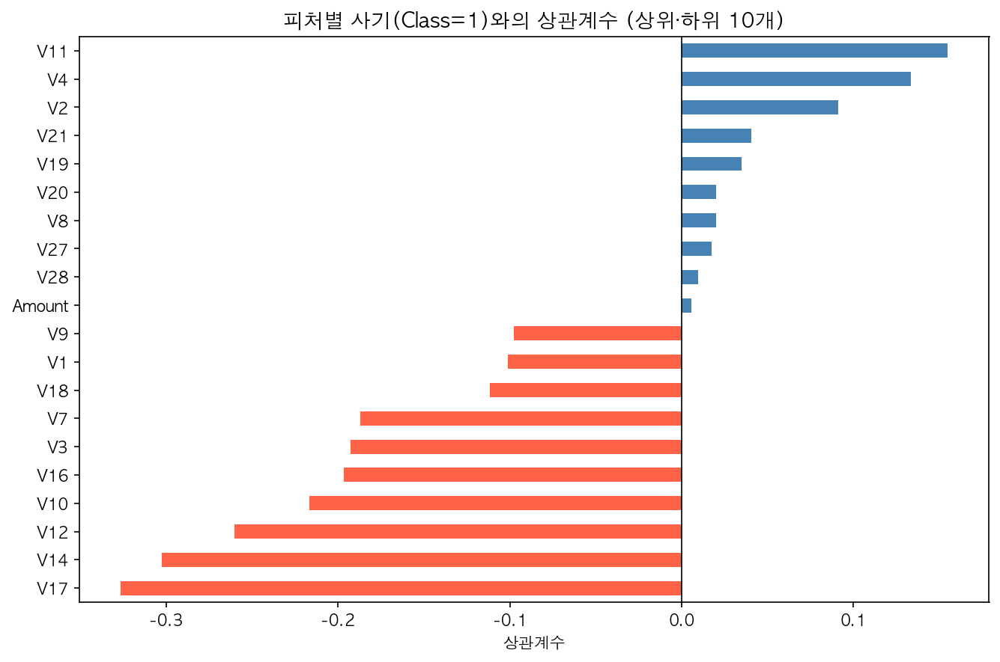
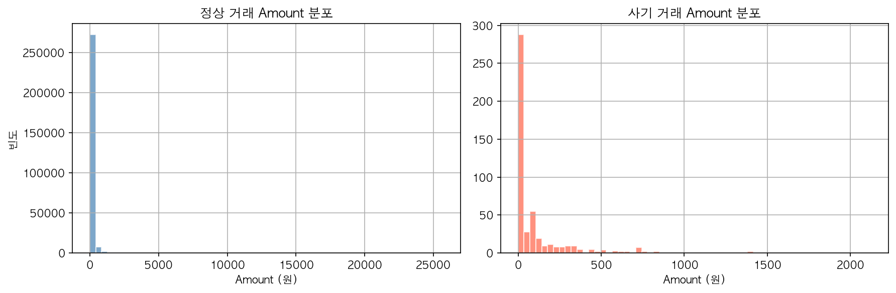

# 신용카드 사기 탐지 딥러닝 모델

TensorFlow/Keras를 활용한 신용카드 사기 거래 이진 분류 프로젝트입니다.

## 프로젝트 개요

실제 신용카드 거래 데이터(284,807건)를 바탕으로 정상 거래와 사기 거래를 분류하는 딥러닝 모델을 구현했습니다.  
데이터의 극심한 불균형(정상 99.83% / 사기 0.17%)을 `class_weight`로 처리한 것이 핵심입니다.

## 모델 성능

| 지표 | 정상 (0) | 사기 (1) |
|------|----------|----------|
| Precision | 1.00 | 0.07 |
| Recall | 0.98 | **0.91** |
| F1-score | 0.99 | 0.13 |

- **전체 정확도**: 98%
- **사기 탐지율(Recall)**: 91% — 사기 거래 98건 중 89건 탐지

> 사기 탐지 도메인에서는 Recall이 핵심 지표입니다. 사기를 놓치는 비용(FN)이 오탐(FP)보다 훨씬 크기 때문입니다.

## 모델 구조

```
Input (30) → Dense(64, ReLU) → Dropout(0.3)
           → Dense(32, ReLU) → Dropout(0.3)
           → Dense(16, ReLU)
           → Dense(1, Sigmoid)
```

- Optimizer: Adam
- Loss: Binary Crossentropy
- Epochs: 20 / Batch size: 512
- 불균형 처리: `compute_class_weight` (사기 클래스에 577배 가중치)

## 결과 시각화

| Loss 변화 | Accuracy 변화 |
|-----------|---------------|
|  |  |

| 클래스 분포 | 혼동 행렬 |
|-------------|-----------|
|  |  |

| 피처-Class 상관계수 | Amount 분포 (정상 vs 사기) |
|---------------------|---------------------------|
|  |  |

## 실행 방법

### 1. 데이터 다운로드

[Kaggle - Credit Card Fraud Detection](https://www.kaggle.com/datasets/mlg-ulb/creditcardfraud) 에서 `creditcard.csv`를 받아 프로젝트 폴더에 넣어주세요.

### 2. 환경 설정

```bash
pip install tensorflow scikit-learn pandas numpy matplotlib seaborn
```

### 3. 노트북 실행

```bash
jupyter notebook 신용카드_사기탐지.ipynb
```

## 데이터셋

- 출처: [Kaggle - Credit Card Fraud Detection](https://www.kaggle.com/datasets/mlg-ulb/creditcardfraud)
- 총 284,807건의 유럽 신용카드 거래 (2013년 9월, 이틀치)
- 피처: V1~V28 (PCA 익명화), Time, Amount (총 30개)
- 타겟: Class (0=정상, 1=사기)

## 기술 스택


